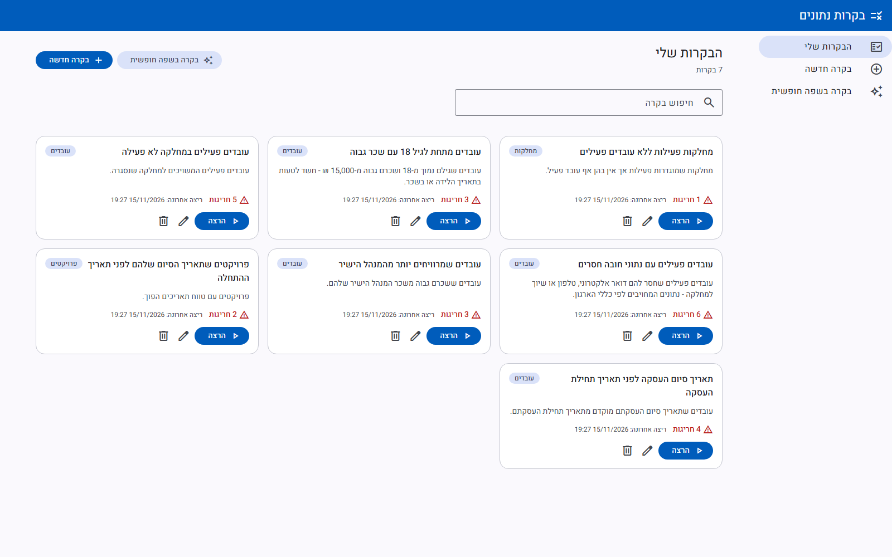
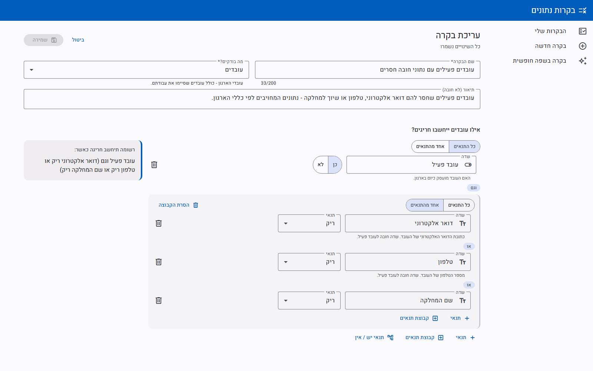
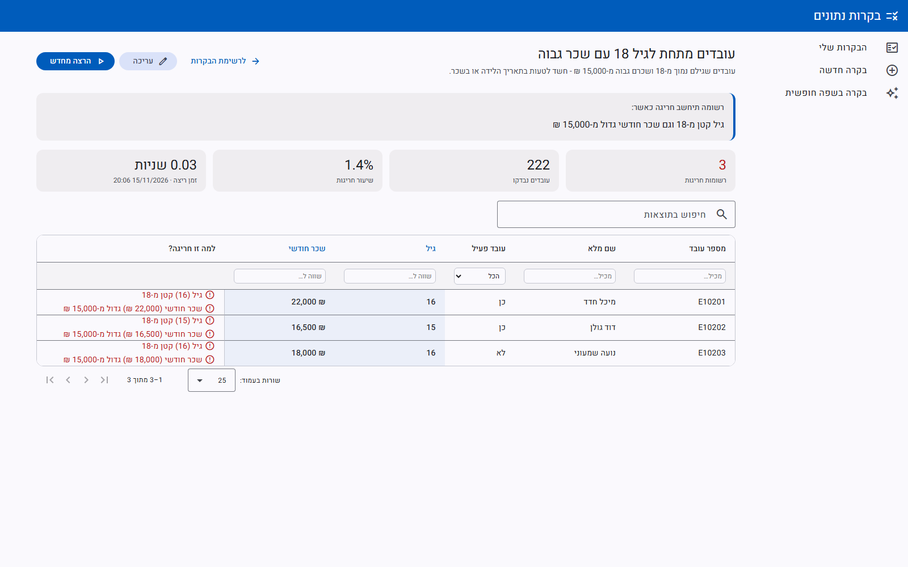
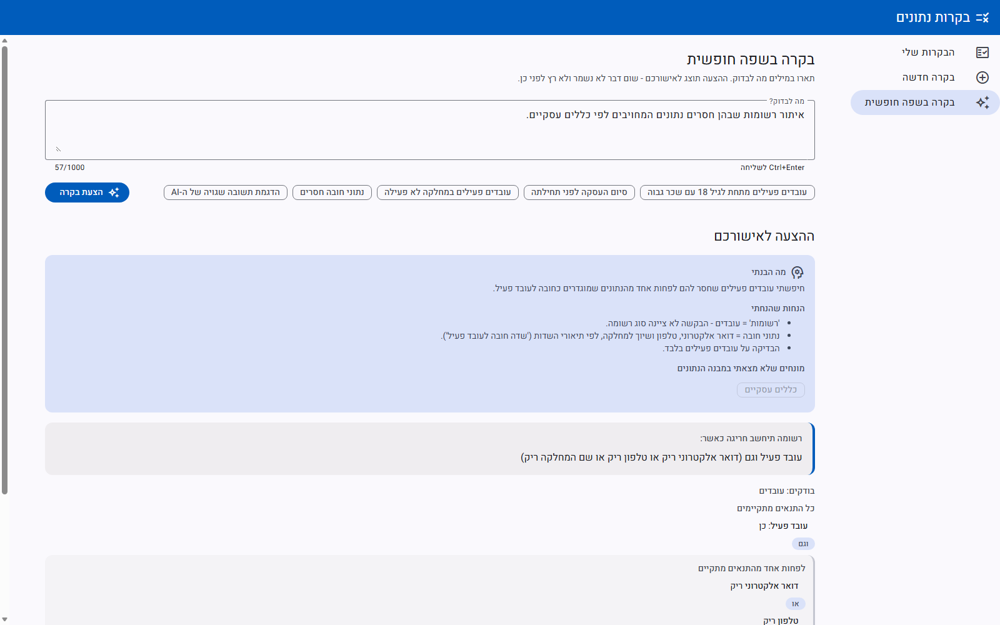

# Dynamic Data Controls System — מערכת בקרות נתונים דינאמית

Business users define data-quality controls **in business terms** — no SQL, no table names — run them, and see every
violating record with a **Hebrew reason**. Controls are stored as data and translated by one generic engine into safe,
read-only SQL. **Stage B:** a control described in free text is proposed by an AI (Mock) and shown for approval before
anything is saved or run.

**.NET 10 Web API · Python / FastAPI · Angular 22 (Hebrew, RTL) · SQL Server**

| Controls list | Editor (no SQL) |
|---|---|
|  |  |
| **Violations with a reason per record** | **Stage B — suggestion for approval** |
|  |  |

## The assignment at a glance

| Requirement | Where |
|---|---|
| Generic controls, separation of definition → SQL → execution, secure SQL | [ARCHITECTURE.md](docs/ARCHITECTURE.md) |
| Database scripts, sample data and 7 sample controls with exact results | `database/` · [SAMPLE-CONTROLS.md](docs/SAMPLE-CONTROLS.md) |
| Stage B: AI infrastructure, Mock demo, a replaceable model | [AI-STAGE-B.md](docs/AI-STAGE-B.md) |
| Optional task: the AI proposes controls on its own | [AI-STAGE-B.md](docs/AI-STAGE-B.md) §6 |
| Assumptions, limitations, extensions | [ASSUMPTIONS-LIMITATIONS.md](docs/ASSUMPTIONS-LIMITATIONS.md) |
| AI tools used | [AI-TOOLS-USED.md](docs/AI-TOOLS-USED.md) |

## Setup and run (Windows)

Needs SQL Server (Express, `.\SQLEXPRESS`, Windows authentication) with `sqlcmd`, .NET 10, Python 3.12 and Node.js 22.22.3+ / 24.15+ / 26+.

```powershell
git clone https://github.com/rachel726/data-controls-system.git
cd data-controls-system
.\database\setup.ps1          # creates and seeds the database, then verifies it (37 checks)
dotnet build backend\DataControls.slnx
cd ai-service; py -3.12 -m venv .venv; .venv\Scripts\python -m pip install -r requirements-dev.txt; cd ..
cd frontend; npm ci; cd ..
.\run-all.ps1                 # starts the API, the AI service and the UI
```

Open **http://localhost:4200** and try:

1. Open **הבקרות שלי** and press **הרצה** on a control — the violations, each with its reason; search, filter, sort.
2. Open **בקרה חדשה** and build conditions from business fields — the control's meaning updates as you build.
3. Open **בקרה בשפה חופשית**, click an example, review the suggestion and approve it.

## Quality

**689 automated tests** — 453 .NET (engine, application, integration on the real database), 139 Angular, 97 Python —
plus 37 database checks. Run: `dotnet test backend\DataControls.slnx` · `npx ng test --watch=false` (in `frontend`) ·
`.venv\Scripts\python -m pytest` (in `ai-service`).

```
database/     create, secure and seed scripts + verification
backend/      Core (the engine, no I/O) · Application · Infrastructure (SQL, AI client) · Api · tests
ai-service/   answer contract, prompt builder, provider interface + Mock, tests
frontend/     core (API, stores) · shared components · features (controls, results, ai)
```

**Troubleshooting:** SQL Server unreachable → start its service (another instance: `run-all.ps1 -SqlServer <name>`) ·
setup failed → `.\database\setup.ps1 -Force` · the free-text page says the AI is unavailable → start the AI service with
`.venv\Scripts\python -m uvicorn app.main:app --port 8001` in `ai-service`.
