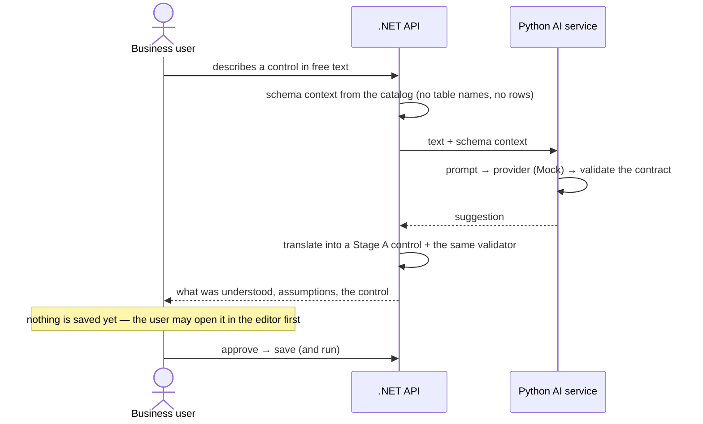
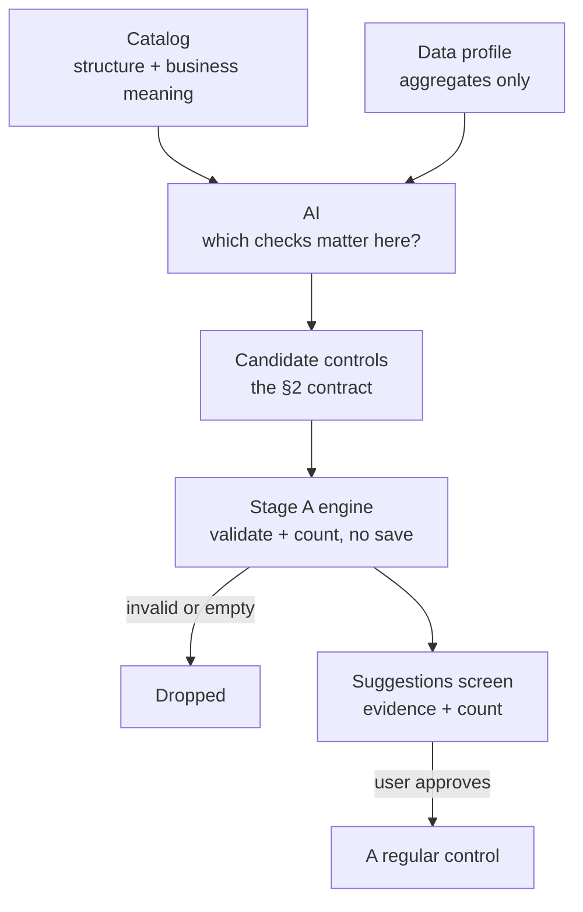

# Stage B — controls from free text (AI infrastructure)

A user describes a control in their own words; an AI proposes a definition; the system translates it into a regular
Stage A control, validates it like a manual one, and shows it **for approval — nothing is saved or run before**. No real
AI is called, as the assignment states: a **Mock** answers, behind the same interface a real model will use.

**How the requirement was read.** The assignment gives the understanding to a future model and asks to demonstrate
*receiving* its answer, in "a flexible infrastructure for different models". So the work went into what every model
needs around it — business context, prompt, answer contract, validation, translation, approval — and the Mock stands in
for the model:

- **The assignment's examples** have prepared answers covering the whole contract, and work as **templates**: the same
  sentence with other numbers, dates or comparisons returns the same answer with the new values.
- **Simple requests** — a field, a comparison and a value — are recognized from the catalog alone.
- **Anything else** gets an honest "not understood", the unknown words, and the manual editor.

The Mock's logic is generic — a test checks that its code contains no business name.

## 1. Flow



| Requirement | Where |
|---|---|
| Free-text interface | `frontend/src/app/features/ai` |
| The data structure and its business meaning for the model | `SchemaContextBuilder` → `PromptBuilder` |
| The expected answer structure | `ai-service/app/models/suggestion.py` → [ai-response.schema.json](ai-response.schema.json) |
| Receiving an answer with a Mock | `ai-service/app/providers/mock.py` |
| Translation into a Stage A control | `AiSuggestionMapper` |
| Approval before running | The review screen |
| AI separated from the engine | `LlmProvider` (Python), `IControlSuggestionClient` (.NET) |

## 2. The answer contract

The AI answers in its **own flat format**, not the engine's — simpler for models, and each side can evolve. The JSON
Schema is generated from the code. An answer (shortened):

```json
{
  "name": "עובדים פעילים עם נתוני חובה חסרים",
  "rootEntity": "employee",
  "logic": "and",
  "conditions": [ { "field": "isActive", "operator": "eq", "value": true } ],
  "groups": [ { "logic": "or", "conditions": [
      { "field": "email", "operator": "isEmpty" },
      { "field": "phone", "operator": "isEmpty" } ] } ],
  "explanation": "חיפשתי עובדים פעילים שחסר להם נתון חובה.",
  "assumptions": ["'רשומות' = עובדים - הבקשה לא ציינה סוג רשומה."],
  "unmappedTerms": ["כללים עסקיים"]
}
```

**The answer is never trusted:** anything outside the contract is rejected (an unknown property such as `"sql"`, an
unknown operator, cut-off JSON), and a field the model invented is shown on its condition and blocks approval.

## 3. The prompt

A system part — the rules (catalog keys only, never SQL, state assumptions) and the JSON Schema — and a user part — the
catalog and the request in `<request>` tags, guarded against prompt injection.

## 4. Demo script

Run the system and open **בקרה בשפה חופשית**:

| Action | Input | Result |
|---|---|---|
| Click the example | עובדים פעילים מתחת לגיל 18 עם שכר גבוה | 3 conditions with assumptions; approve and run → 2 violations |
| Click the example | הדגמת תשובה שגויה של ה-AI | An invented field is caught; approval is disabled |
| Type | מצא עובדים פעילים שגילם גבוה מ־60 ומשכורתם נמוכה מ־5,000 ש"ח | The example's answer with the new values and comparisons |
| Type | עובדים עם מספר נעליים מעל 40 | "Not understood", the unknown words, and the manual editor |

## 5. Replacing the Mock with a real model

Only the Python service changes — the controls engine, the API and the UI stay as they are:

```python
class RealModelProvider:                      # next to providers/mock.py
    name = "real-model"

    async def generate(self, prompt: Prompt) -> str:
        ...  # call the model with prompt.system and prompt.user; return its raw text
```

Register it in `providers/factory.py` and `config.py`, and start the service with `AI_PROVIDER=real-model`. The
timeout, JSON extraction, strict validation and retries are already in place.

## 6. Design — the AI proposes controls on its own (optional task, design only)

**Goal:** without being asked, the AI studies the structure of the database and proposes the data-quality controls that
matter, each with the evidence for it — and the user decides.



**What the AI receives** is the schema context Stage B already sends — entities, fields with their business meaning
(e.g. that an email is required for an active employee), types and relations — plus a **profile**: aggregates computed through
the same read-only engine (empty share per field, value ranges, reversed date pairs, links to inactive records).
**Only aggregates leave the database, never rows.**

**What it looks for.** Structural patterns can be found by rules, with no model; the AI adds what needs business
meaning — a sensible threshold, which comparisons make sense.

### A worked example on the sample database

To check the design before building it, it was **applied by hand to the real catalog**: the patterns below were looked
for in the catalog, a control was written for each match, and **every number comes from the real database** — each
candidate was run as a control through the system's engine.

| Pattern in the structure | Found in the catalog | Proposed control | Profile | Outcome |
|---|---|---|---|---|
| A field required by the business (rule) | דואר אלקטרוני, טלפון, מחלקה | עובדים פעילים עם נתוני חובה חסרים | 2 + 2 + 2 of 186 active employees | **6** — kept |
| Two dates of one record (rule) | תאריך תחילת העסקה, תאריך סיום העסקה | תאריך סיום העסקה לפני תאריך תחילת העסקה | reversed in 4 | **4** — kept |
| Two dates of one record (rule) | תאריך התחלה, תאריך סיום | פרויקטים שתאריך הסיום שלהם לפני תאריך ההתחלה | reversed in 2 | **2** — kept |
| Two dates of one record (rule) | תאריך לידה, תאריך תחילת העסקה | עובדים שהועסקו לפני שנולדו | 0 | dropped |
| A link to a record that can be inactive (rule) | עובד ← מחלקה פעילה | עובדים פעילים במחלקה לא פעילה | 5 | **5** — kept |
| A link to a record that can be inactive (rule) | עובד ← מנהל ישיר פעיל | עובדים פעילים שהמנהל שלהם אינו פעיל | 0 | dropped |
| A record that should have related records (rule) | מחלקה פעילה ← עובדים | מחלקות פעילות ללא עובדים פעילים | 1 of 8 active departments | **1** — kept |
| A business threshold (AI) | גיל, שכר חודשי | עובדים מתחת לגיל 18 עם שכר גבוה | 3 under 18, all above 15,000 ₪ | **3** — kept |
| A comparison along a relation (AI) | שכר חודשי, מנהל ישיר | עובדים שמרוויחים יותר מהמנהל הישיר | 3 | **3** — kept |
| A value range (AI) | שכר חודשי | עובדים עם שכר אפס או שלילי | 0 (8,296–39,000 ₪) | dropped |

The kept candidates are exactly the problems planted in the sample data, and the empty ones are dropped — the design
works on real data. **Every number can be checked in the system:** the kept candidates match the 7 sample controls in
the list (press **הרצה**), and any candidate, kept or dropped, can be built in **בקרה חדשה**.

### Steps and contracts

1. **Profile** — a profiler builds the aggregate queries from the catalog with the existing renderer and read-only
   executor; it can run nightly.
2. **Propose** — `POST /v1/propose-controls` in the AI service: the schema context and the profile in; a list of
   `ControlSuggestion`s out, each with `evidence` and `reason`. Rule-based candidates are merged in.
3. **Check** — every candidate is translated and validated like a Stage B answer, then counted by a preview run
   (`POST /api/controls/preview`, no save); the invalid and the empty ones are dropped; the rest are ranked by impact.
4. **Decide** — a suggestions screen: the evidence, the count and the sample violations; approve → a regular control;
   dismissed candidates are not proposed again.

**Already built and reused:** the schema context, the answer contract, the validator, the SQL renderer, the read-only
executor and the approval flow. **New:** the profiler, the propose and preview endpoints, a suggestions store and
screen, and a schedule.
