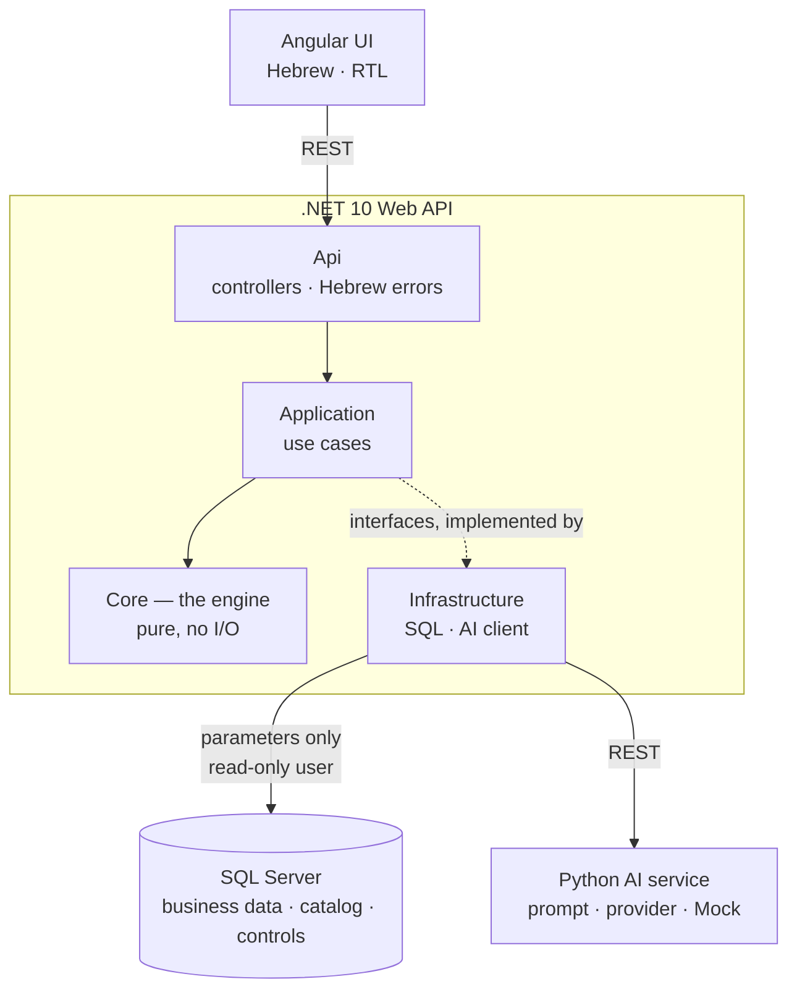
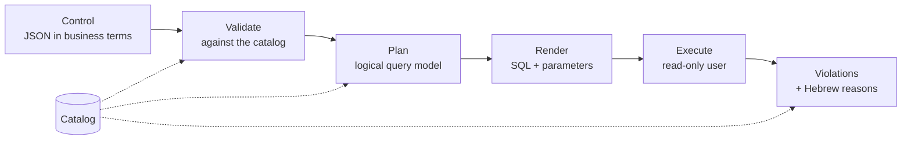

# Architecture and the control mechanism

## 1. The idea

A **control** describes a problem — "employees under 18 earning over 15,000". It is stored as **data**: a JSON
condition tree in business terms (`age`, `salary`, `department.isActive`). A **catalog** in the database maps business
terms to tables, columns and relations. One generic engine validates the control against the catalog, translates it
into SQL and runs it read-only; every matching record is a **violation** with a Hebrew reason. A new control needs no
code; a new field or table needs only catalog rows.

## 2. Components and the pipeline



The UI talks only to the API; only the API reaches the database and the AI. Architecture tests keep the engine free of
SQL and HTTP.



| Stage | Component | What it does |
|---|---|---|
| Definition | `DefinitionValidator` | Checks every field, operator, value and limit against the catalog; Hebrew errors on the exact condition |
| Translation | `QueryPlanner` | Fields of related records → joins; "related records" → `EXISTS` / `NOT EXISTS`; a flag per condition. Database-independent |
| Translation | `SqlServerRenderer` | SQL + typed parameters; identifiers only from the planned model (taken from the catalog); paging, search, filters, sort; `SELECT` only |
| Execution | `SqlQueryExecutor` | Read-only user, timeout, row cap |
| Explanation | `ViolationReasonBuilder` | The flags + the row's values → a Hebrew reason per record |

Sample control 7 ("active department with no active employees"), as rendered:

```sql
WITH v AS (
    SELECT r.[Id] AS [__id], r.[Name] AS [__title], r.[Name] AS [name], r.[Code] AS [code], r.[IsActive] AS [isActive],
           CASE WHEN r.[IsActive] = @p0 THEN 1 ELSE 0 END AS [__c0],
           CASE WHEN NOT EXISTS (SELECT 1 FROM [biz].[Employees] AS x1 WHERE x1.[DepartmentId] = r.[Id] AND (x1.[IsActive] = @p1)) THEN 1 ELSE 0 END AS [__c1]
    FROM [biz].[Departments] AS r
    WHERE (r.[IsActive] = @p0 AND NOT EXISTS (SELECT 1 FROM [biz].[Employees] AS x1 WHERE x1.[DepartmentId] = r.[Id] AND (x1.[IsActive] = @p1)))
)
SELECT *, COUNT(*) OVER () AS [__total] FROM v ORDER BY v.[__id] ASC OFFSET @p2 ROWS FETCH NEXT @p3 ROWS ONLY;
```

The flags `__c0` / `__c1` let the reason name exactly the conditions a record met — in an OR group, only the branch that matched.

**A control can express:** comparisons by type (dates: before / after), between, one of, contains, empty; comparison
with **another field**; fields of a related record; AND / OR groups nested three levels; "there are / there are no"
related records; computed fields (age, full name) declared in the catalog — never free SQL.

## 3. Generic by design

No business table or field name appears in C#, Python or TypeScript. Entities, fields (Hebrew names, types, allowed
values, units) and relations come from the catalog, and the UI builds itself from it — the field picker, operators and
inputs per type, result columns and filters. How to add a field or a table: [SAMPLE-CONTROLS.md](SAMPLE-CONTROLS.md).

## 4. Security

| Threat | Defence |
|---|---|
| SQL injection | Values are typed parameters; identifiers come only from the catalog |
| Changing data | Only `SELECT` is rendered, and it runs as a user that can only read business data — even an engine bug cannot change data |
| Expensive queries | Timeout, row cap, page size, limits on conditions, nesting and text |
| Leaking details | Unexpected errors → a Hebrew message with a trace id, never SQL or framework text |
| Trusting the AI | A strict contract, the same validator as a manual control, and the user's approval |

## 5. Key decisions

| Decision | Why |
|---|---|
| Own validator → planner → renderer, not an ORM | Per-condition reasons, catalog-only identifiers, a clean separation of the stages |
| A logical query model before SQL | Another database = another renderer |
| Catalog in the database, cached in the API | One source of truth for the engine, the UI and the AI; no deployment for changes |
| Read-only user + `EXECUTE AS`; `READ_COMMITTED_SNAPSHOT` | Defence in depth; reading never blocks saving |
| One set of limits, served by the API | The validator, the UI and the AI share it |
| AI in a separate service behind an interface | The model is replaceable without touching the engine |
| Angular signals, a store per screen | Simple, explicit state; the latest request always wins |

## 6. Quality

689 automated tests (453 .NET, 139 Angular, 97 Python) and 37 database checks — including every sample control's exact
result on the real database, the executor's security, and a cross-language test that the Mock's answers translate to
the hand-built sample controls. Changes were verified end to end in a browser at desktop and phone widths.
